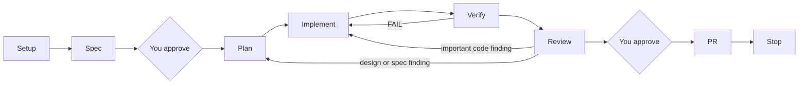

# Delivery workflow

How Claude Code delivers changes to Lamb Chomp. Adapted from the Tripod workflow, with the gates made mechanical.

## Commands

Run these in Claude Code from the main checkout:

| Command | Use it for |
|---|---|
| `/deliver-feature <request>` | A new feature or change |
| `/fix-bug <report>` | A bug |
| `/new-levels <brief>` | New levels, e.g. `/new-levels world 3 mud, 18 levels` |
| `/<command> resume <slug>` | Continue a run after a break or a new session |

Each run works in its own git worktree at `~/Projects/lamb-chomp-worktrees/<slug>` on branch `feature/<slug>` or `fix/<slug>`, so parallel runs and your own checkout never collide. Run state lives in that worktree's git-ignored `.delivery/` folder: `state.md` (current step, flags, retry counts, Known issues), `spec.md` or `bug.md`, `plan.md`, `verify.md`, `review.md`, `gate.json`, and `evidence/` (screenshots, Maestro output).

## The graph

- **Spec approval** can be skipped only for a UI-only change with no other impact flags, when you asked for a non-stop run.
- **Retry caps:** 2 Verify→Implement loops and 2 Review→Implement loops. After that, Claude stops and shows you the evidence.
- **PR, then stop.** Claude never merges, force-pushes, publishes an EAS build, or submits to a store.

Bug variant: Setup → Reproduce + root cause (a failing test first) → risk gate (asks you if the fix touches `save`, `economy` or `native`, or changes intended behavior) → Fix → Verify → Review → your approval → PR.

Levels variant: Setup → Brief → Generate candidates → Solver-verify and score → **you hand-pick** from a shortlist → write levels → Verify → Review → your approval → PR.

## Gates and how they are enforced

| Gate | Enforced by |
|---|---|
| Typecheck, lint, Jest, level gate (every level solvable, stored par = true minimum), economy gate | `npm run gate`, which writes `.delivery/gate.json`. CI should run the same checks on the PR. |
| Verification was done, and passed | The `feature-verifier` subagent writes `verify.md` with `Overall: PASS` and `Commit: <sha>`. |
| Independent review approved | A fresh `feature-reviewer` subagent writes `review.md` with `Verdict: APPROVE` (zero `important` findings) and `Commit: <sha>`. |
| Nothing changed after verify and review | A PreToolUse hook blocks `gh pr create` unless both files carry those lines, both shas equal the current `HEAD`, and the working tree is clean. |
| Nothing lands on `main` without you | You merge the PR. Branch protection on GitHub is the server-side backstop (see below). |

The orchestrating Claude is not allowed to verify or review its own work; that happened once in Tripod and is why the hook exists. Any commit after Verify or Review means both are run again.

Verification evidence uses fixed statuses: `PASS`, `FAIL`, `PRE-EXISTING` (only after reproducing the same failure on an `origin/main` base worktree), `CARRIED` (unchanged code, earlier result), `NOT RUN`, `MANUAL` (physical-device feel, Android, store steps). Problems found but not fixed go into a Known issues list, which is shown at the PR gate and copied into the PR body.

Tests are protected: every new guarding test is proved by removing the code it guards and watching it fail, and no test, gate script or golden fixture may be weakened to get a pass.

## Impact flags

Set at spec time; each adds required checks. Full list in `.claude/skills/deliver-feature/references/lambchomp-risks.md`.

| Flag | Means | Extra checks |
|---|---|---|
| `rules` | Changes the pure rules module in `src/game/` | Golden replays, prototype parity, fast-check properties. Core rules need your approval. |
| `levels` | Changes levels or the solver | `npm run gate:levels`; worlds of 15–20 each introduce one component |
| `ui` | Screens, gestures, animation | Maestro flows and screenshots on iPhone SE and Pro Max, swipe feel, 60fps sanity |
| `economy` | Coins, shop, ads, purchases | Economy gate and coin balance sim; rewarded hint ads only, no interstitials |
| `save` | Anything persisted | Migration test: previous version's progress and coins still load; upgrade-install check |
| `native` | Expo config, plugins, native packages, EAS | `npx expo-doctor`, `npx expo prebuild --clean`, simulator build |

## How Verify runs the app

The verifier runs `npm run gate`, builds a Release build with `npx expo run:ios --configuration Release`, installs it on two simulators the run creates for itself (iPhone SE and a Pro Max), runs every flow in `.maestro/`, and saves screenshots to `.delivery/evidence/`. Details: `.claude/skills/deliver-feature/references/native-verification.md`.

## Still manual

- **Install Maestro** (and Java 17+): `brew tap mobile-dev-inc/tap && brew install mobile-dev-inc/tap/maestro`. Until it is installed, Verify reports `BLOCKED`.
- **Xcode simulator runtimes** for an iPhone SE and a current Pro Max.
- **GitHub branch protection on `main`:** require a PR, passing CI, and no force-pushes. The hook only guards Claude's own `gh pr create`; branch protection guards everything else.
- **`gh auth login`** so Claude can open PRs.
- **Merging,** EAS builds, TestFlight and store submission.
- **Feel on a real phone:** swipe feel and frame rate are `MANUAL` checks for you at the PR gate.
- **Cleanup** after merge: ask Claude to clean up the run (removes the worktree and the run's simulators), or `git worktree remove ~/Projects/lamb-chomp-worktrees/<slug>`.
